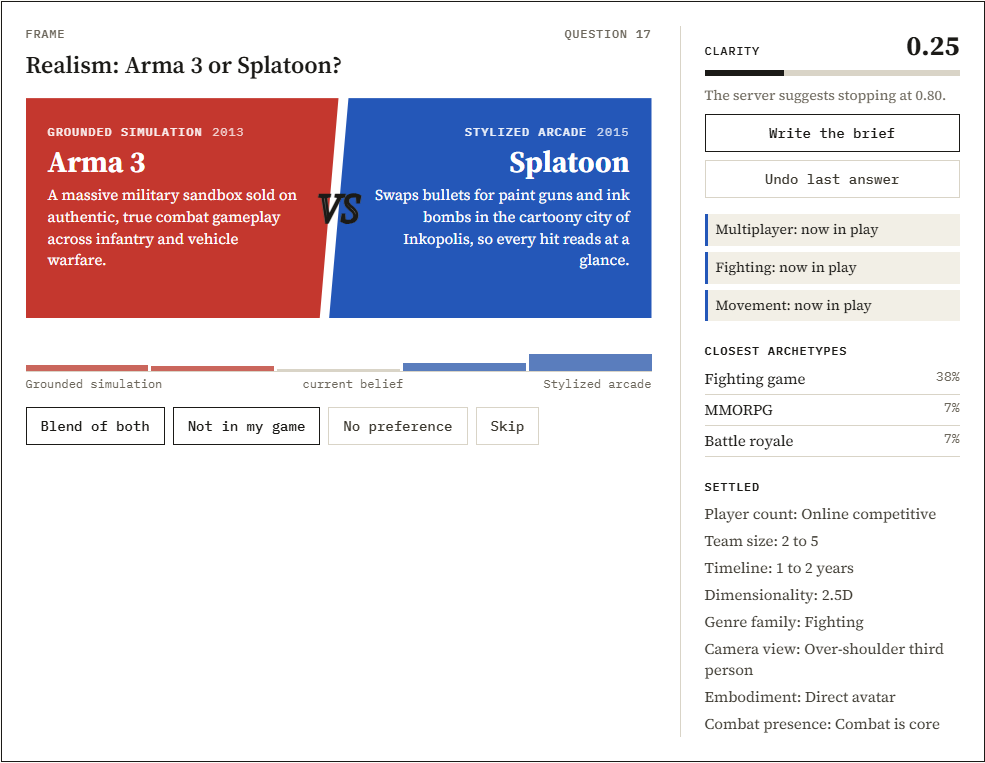

# game-design-versus

**Find the game you mean by choosing between games that exist.**

A this-or-that interview for game design. Each question puts two or three real games head to head on one design
axis ("Combat simulation: Half Sword or Skyrim?"). Every answer narrows 154 axes across 27 modules, and whole modules
drop away when they do not apply. At the end the server writes a GDD seed brief: pitch, pillars, core loop, systems,
comparable titles, scope, risks and open questions.

It is a Claude Code plugin and an MCP server for any agent (Cursor, Codex, VS Code with Copilot, Claude Desktop). The
server is deterministic: it never calls a model and needs no API key.

[Website](https://tmhsdigital.github.io/game-design-versus/) ·
[Try it in your browser](https://tmhsdigital.github.io/game-design-versus/#demo) ·
[Sample brief](examples/GDD.sample.md) ·
[Agent protocol](AGENTS.md)

[](https://tmhsdigital.github.io/game-design-versus/#demo)

## Install

In Claude Code:

```
/plugin marketplace add TMHSDigital/game-design-versus
/plugin install game-design-versus@tmhs-digital
```

Then start an interview:

```
/game-design-versus:versus a medieval sword fighter where the physics decide every hit
```

The agent asks up to four questions per round, records your answers, raises risks as they appear ("physics melee in
online PvP is hard to network") and stops when the design is clear. `/game-design-versus:versus-brief <session id>`
writes the brief again for any saved session.

<details>
<summary>Other clients: Cursor, Codex, VS Code, Claude Desktop</summary>

Clone the repo and point the client at the single-file server `plugins/game-design-versus/server/index.js`. It needs
Node 20 or newer and has no runtime dependencies. If you change the source, run `npm ci && npm run build`.

**Cursor**: `.cursor/mcp.json` in a project, or `%USERPROFILE%\.cursor\mcp.json` for all projects:

```json
{ "mcpServers": { "gdv": { "command": "node", "args": ["C:/path/to/game-design-versus/plugins/game-design-versus/server/index.js"] } } }
```

**Codex**: `%USERPROFILE%\.codex\config.toml` (single-quoted TOML strings avoid backslash escaping):

```toml
[mcp_servers.gdv]
command = "node"
args = ['C:\path\to\game-design-versus\plugins\game-design-versus\server\index.js']
```

**VS Code with Copilot**: workspace `.mcp.json`:

```json
{ "mcpServers": { "gdv": { "type": "stdio", "command": "node", "args": ["C:/path/to/game-design-versus/plugins/game-design-versus/server/index.js"] } } }
```

A legacy `.vscode/mcp.json` uses `servers` instead of `mcpServers`.

**Claude Desktop**: `%APPDATA%\Claude\claude_desktop_config.json`, or for the Microsoft Store build
`%LOCALAPPDATA%\Packages\Claude_<id>\LocalCache\Roaming\Claude\claude_desktop_config.json`:

```json
{ "mcpServers": { "gdv": { "command": "node", "args": ["C:/path/to/game-design-versus/plugins/game-design-versus/server/index.js"] } } }
```

Once the package is on npm, any of these can use `"command": "npx", "args": ["-y", "game-design-versus"]` instead.
Agents without a structured question tool can follow the numbered-list protocol in [AGENTS.md](AGENTS.md).

</details>

## How it works

The work is split in two:

- **The agent interviews.** It words each question, renders it with AskUserQuestion or as a numbered list, maps free
  text to answers, asks the probe of any risk the server raises and improvises follow-ups.
- **The server referees.** It owns the ontology, the comparison library, the event-sourced session, the scoring and
  the choice of the next question, and it writes the brief.

Inside the server:

| Piece | What it does |
| --- | --- |
| Belief per axis | Each two-pole axis is a probability over 5 bins (strong A, lean A, blend, lean B, strong B). Picking A multiplies in 0.50, 0.30, 0.14, 0.04, 0.02 (B mirrors); a blend multiplies in 0.05, 0.20, 0.50, 0.20, 0.05; an explicit lean of 0 to 100 is a Gaussian with sigma 0.6. |
| Archetypes | A posterior over 48 archetypes (soulslike action RPG, colony sim, roguelike deckbuilder and more) updates from the same answers and supplies the prior for every axis not yet asked. |
| Gating | Gate axes set flags such as `has_combat` or `is_multiplayer`. A module whose flag is false is skipped whole. Gating is three-valued, and gates are asked first. Presence gates ("is there crafting at all?") are asked up to four at a time as one "which of these are in your game?" checklist. |
| Next question | Questions come in phases: core frame axes and gates, then core (importance 3) axes, then refinement. Within a phase: importance times expected information gain on the axis, plus 0.5 times the gain on the archetypes, plus gate and familiarity bonuses, minus repetition penalties. A per-session seed picks from the top 3, so sessions replay exactly (`GDV_DETERMINISTIC=1` forces the top pick). |
| Stopping | Clarity per axis is 1 - H(p)/log(n). The brief is ready, and the server recommends stopping, when the core frame axes and gates are resolved, every core axis is at 0.6 clarity or more, and either overall clarity reaches 0.80 or two rounds (8 questions) went to refinement. Secondary axes still open become the brief's open questions; the user can keep going. From 48 questions the stop is recommended once frame and gates are resolved, with any open core axis listed first among the open questions; 60 is a hard cap. |
| Comparable titles | Elo ratings over the games you picked (K 24, start 1500). |
| Tensions | 35 rules (netcode risk for physics PvP, an MMO on a solo team, the patented Nemesis system and more) fire as answers arrive and come back with a probe question. |

In simulation (`npm run simulate`), 8 personas answering from a hidden profile all get a ready brief within 32
questions, none is asked about a module that does not apply, and each persona's own archetype ranks first.

| Persona | Questions | Clarity | Top archetype |
| --- | --- | --- | --- |
| Physics brawler (Half Sword) | 32 | 0.795 | physics_brawler |
| Business sim (Big Ambitions) | 26 | 0.793 | business_tycoon |
| 4X (Civilization VI) | 30 | 0.767 | x4 |
| Cozy farming | 27 | 0.796 | cozy_farming |
| Extraction shooter | 28 | 0.773 | extraction_shooter |
| Roguelike deckbuilder | 28 | 0.798 | roguelike_deckbuilder |
| Survival horror | 28 | 0.781 | survival_horror |
| Party game | 27 | 0.808 | party_game |

Real games are rarely one archetype, so the simulation also runs 40 hybrid users. Each game mixes two archetypes (per
module, or axis by axis), questions come 4 per round, and the user answers blend 15% of the time, "not sure" on 10%
of game questions and "no preference" on 4%. Hybrids need a median of 40 (module mix) or 44 (axis mix) questions,
about 10 rounds, at most 48, and none reaches the 60-question cap.

<details>
<summary>Calibration notes</summary>

These documented deviations from a literal reading of the original spec keep interviews short. All live in
`src/engine/config.ts`:

- The prior's uniform share starts at 0.3 and decays to 0.02 as the archetype posterior concentrates.
- An axis the user answered directly counts as at least 0.9 clear (`decidedClarityFloor`); a "no preference" axis
  counts as settled.
- Archetype profiles are completed with weak (+-1) rule-based defaults for axes they did not specify, for example a
  single ending unless the story branches.
- The 0.80 overall target applies only until refinement has had two rounds (`detailQuestions`): a hybrid game has
  over 100 applicable axes, and no interview can ask them all. Only tier-0 frame axes of core importance and gates
  are asked first; secondary frame facts (engine, rating, session length) are refinement.
- From `softQuestions` (48) the stop is recommended once frame and gates are resolved, so hybrids whose inferences
  keep shifting still end with a usable brief.

Your own answers always set the position of a decided axis; the archetype prior only fills open axes.

</details>

## The brief

`versus_brief` returns Markdown or JSON with 12 sections after the pitch: frame, experience targets, genre, design
pillars, core loop, systems spec, comparable titles, USPs and non-goals, scope, risks, open questions and a decision
log. It states only what you decided or what the evidence strongly implies, and lists the rest as open questions.
Read [examples/GDD.sample.md](examples/GDD.sample.md) for a full brief from a 32-question session.

## The library

Each comparison is one axis, two or three games, and a description of 160 characters or fewer of how each game
handles that axis and nothing else. Every option cites a source.

```json
{
  "id": "cmp.combat.sim.halfsword-skyrim",
  "axis": "combat.sim",
  "options": [
    { "pole": "physics", "game": "Half Sword", "year": 2026, "how": "Weapons are physical objects steered by the mouse on active-ragdoll bodies; ..." },
    { "pole": "animated", "game": "The Elder Scrolls V: Skyrim", "year": 2011, "how": "Swings play animations, hits register on contact, ..." }
  ],
  "tags": { "genres": ["action", "rpg"], "platforms": ["pc", "console"], "era": "2010s", "indie": true },
  "sources": [
    { "url": "https://store.steampowered.com/app/2397300/Half_Sword/", "note": "..." },
    { "url": "https://en.uesp.net/wiki/Skyrim:Combat", "note": "..." }
  ],
  "verification": { "status": "verified", "checkedAt": "2026-11-23", "by": "seed" }
}
```

Coverage for v0.1.0 (`npm run coverage`):

```
Comparisons served: 653 (verified 653, unverified 128); targets >= 600, stretch 1000
Distinct games: 705; top: Mario Kart 8 Deluxe 10, Darkest Dungeon 9, Animal Crossing: New Horizons 9, Terraria 9
Indie share: 66.8% (target >= 30%)
Eras: pre2000 15.9%, 2000s 21.6%, 2010s 51.0%, 2020s 11.5% (each >= 10%)
Per genre: every family >= 33 (target 25)
Thin bipolar axes (< 4): combat.commitment=2, combat.numbers=2, combat.ai=3, ranged.assist=3,
  stealth.failure=3, ui.diegesis=2, audio.music=3, audio.sync=3, strat.micro=2, strat.victory=2
Uncovered categorical poles: none
Overused games (> 12): none
```

Only verified comparisons are served; set `GDV_ALLOW_UNVERIFIED=1` to include the rest. The 10 thin axes are reported
as warnings, not failures, and unverified candidates already exist for most of them. Until they are sourced, an axis
without a comparison falls back to a plain question about its two poles.

### Contributing comparisons

Sourcing the thin axes is the most useful contribution. Read [docs/library-brief.md](docs/library-brief.md); in short:

- One axis per comparison, and neither option obviously better.
- At least one source per option: a Steam store page or official site, an official or community wiki, a reputable
  review (PC Gamer, IGN, Eurogamer, Game Developer) or a GDC talk. Never invent mechanics.
- Mark an item `verified` only when every option was checked against its source.
- Run `npm run validate:data` and `npm run coverage`. No em dashes or emoji anywhere.

## Reference

<details>
<summary>Tools, resources and prompts</summary>

| Tool | Purpose |
| --- | --- |
| `versus_start { title?, pitch?, knownGames?, seed?, constraints?: { platform?, team?, timeline? } }` | New session; returns a summary |
| `versus_next { sessionId, count?: 1-4 }` | Up to 4 questions from different modules, each with a ready `askUserQuestion` object and an `answerMap` |
| `versus_answer { sessionId, answers: [{ questionId, choice, lean?, note?, selected? }] }` | Record answers; returns clarity deltas, unlocked and skipped modules, tensions and follow-up hints |
| `versus_ask { sessionId, axis \| customAxis, options: [{ game, how }] }` | Register an improvised (unverified) comparison and get a questionId |
| `versus_set { sessionId, axis, value, confidence, source }` | Record a fact the user volunteered |
| `versus_reply { sessionId, tensionId, response, stance?: accepted \| mitigated \| will_change }` | Record the reply to a tension probe; the brief shows it under that risk instead of the probe, and the tension is not raised again |
| `versus_status { sessionId }` | Core decisions settled, clarity per module, settled decisions, tensions, archetypes, comparables |
| `versus_undo { sessionId, round?, steps? }` | Undo the last answer, set or skip; `round: true` undoes the whole last `versus_answer` call, `steps` undoes up to 10 events |
| `versus_list {}` | Saved sessions |
| `versus_brief { sessionId, format: markdown \| json, outPath?, overwrite? }` | The GDD seed brief; a relative outPath resolves against the server's working directory, and an existing file is only replaced with `overwrite: true` |
| `versus_catalog { module?, axis?, game?, query? }` | Browse axes and comparisons |

Choices: `a`, `b`, `c`, `d` (options), `blend`, `neither` (Other, with `note`), `no_pref`, `na` (not in my game),
`unsure` (the user does not know the games; no evidence is recorded, games they do not know are avoided, and the
topic returns a couple of answers later in plain words), `skip`. Multi-select questions take `selected` option keys.
Questions that show games always offer "Not sure / don't know these games". When an answer does not fit the
4-option limit (usually "Blend of both"), it is listed in `moreOptions` and still mapped in `answerMap`.

Resources: `gdv://ontology`, `gdv://axes/{axisId}`, `gdv://comparisons/{axisId}`, `gdv://sessions/{sessionId}`,
`gdv://sessions/{sessionId}/brief`. Prompts: `versus` (pitch), `versus-resume` (sessionId), `versus-brief`
(sessionId). MCP elicitation is not used in v1.

In Claude Code the plugin's tools are named like `mcp__plugin_game-design-versus_gdv__versus_start`; run `/mcp` to
confirm before adding any of them to `allowed-tools`.

</details>

<details>
<summary>Data files</summary>

- `src/data/axes.json`: modules and axes (`id`, `module`, `kind` bipolar | categorical | multi | rank | gate, `poles`,
  `appliesWhen`, `sets`, `importance`, `tier`, `questionTemplate`, `header`).
- `src/data/archetypes.json`: 48 archetypes with profiles (`axis: bin -2..2`, or a pole id, or pole ids).
- `src/data/tensions.json`: 35 rules `{ id, when, severity, message, probe }`.
- `src/data/comparisons/<module>.json`: the comparison library.

</details>

<details>
<summary>Environment variables</summary>

| Variable | Effect |
| --- | --- |
| `GDV_HOME` | Where sessions are stored. Default `%USERPROFILE%\.game-design-versus` (`~/.game-design-versus`). One JSON file per session under `sessions\`, written atomically, never inside the plugin folder (updates replace it). |
| `GDV_DETERMINISTIC=1` | Always pick the top-scoring question instead of a seeded pick from the top 3. |
| `GDV_ALLOW_UNVERIFIED=1` | Also serve comparisons marked unverified. |

</details>

<details>
<summary>Troubleshooting</summary>

- **No tools in the client.** Check the path to `server/index.js` and that `node --version` is 20 or newer. Run
  `npm run inspect` to see the server's stderr log.
- **"session not found".** Sessions live in `GDV_HOME`; a client started with a different `GDV_HOME` will not see
  them. Use `versus_list`.
- **Few questions use real games.** Only verified comparisons are served. Set `GDV_ALLOW_UNVERIFIED=1` to include the
  rest, or contribute sources.
- **Windows paths in JSON.** Use forward slashes or doubled backslashes; in TOML use single-quoted literal strings.

</details>

## Development

```
npm ci
npm run check       # typecheck, lint, validate:data, build, test, coverage
npm run dev         # tsx watch
npm run simulate    # persona simulation (8 personas, 40 hybrid users)
npm run inspect     # MCP Inspector against the built bundle (needs Node 22+)
npm run site        # build the website into _site/ and serve it on http://localhost:4173
```

The committed bundle `plugins/game-design-versus/server/index.js` must be rebuilt with `npm run build` after any
change under `src/`; CI fails if it is stale. The website lives in `site/`, runs the engine through
`src/web/demo.ts`, and deploys to GitHub Pages on every push to `main`.

Built with `@modelcontextprotocol/server` 2.4.0 (served with `serveStdio`, so 2025-era and 2026-07-28 clients both
work), zod 4.6.7, TypeScript 6.0.3, esbuild and vitest 4.1.12.

## License

MIT, Thomas Mathes / TMHSDigital.
